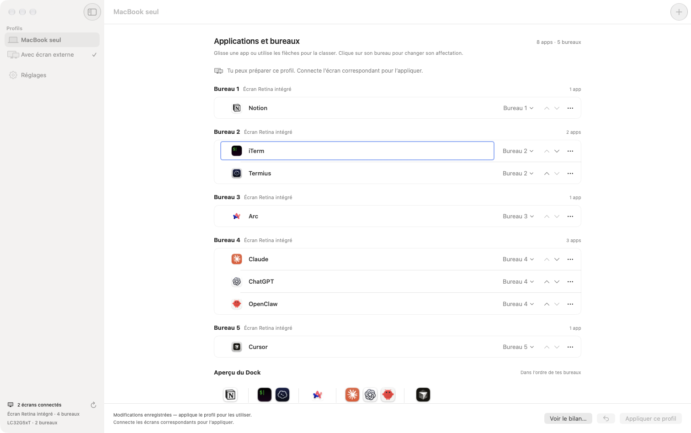
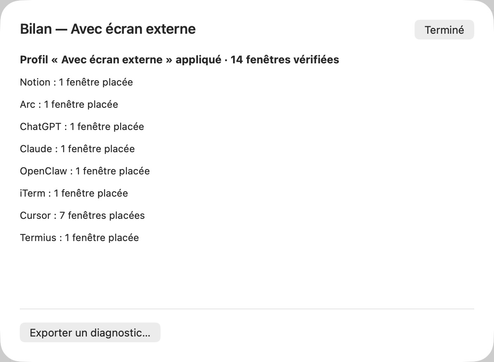

# Spaces Dock

**Retrouve tes applications sur les bons bureaux, avec le Dock Apple organisé dans le même ordre.**

Notion sur le bureau 1, les terminaux sur le bureau 2, le navigateur sur le bureau 3… Spaces Dock mémorise cette organisation et replace les fenêtres quand tu appliques ton profil. Tu peux préparer une disposition pour ton MacBook seul et une autre avec un écran externe.

**[Télécharger Spaces Dock 0.6.2 pour Mac Apple Silicon](https://github.com/emieuxcharles/Spaces-Dock/releases/download/v0.6.2/Spaces-Dock-0.6.2-21-arm64.zip)** · [Toutes les versions](https://github.com/emieuxcharles/Spaces-Dock/releases)

App native en français · macOS 26 et 27 · Dock Apple conservé · ZIP signé et notarifié par Apple

> La version 0.6.2 est une préversion de validation. Le placement a été testé sur macOS 27.2, avec des validations historiques sous 26.5.2. Consulte les [résultats et limites des essais](docs/RELEASE.md).



*Chaque groupe correspond à un bureau. Les applications et leur ordre sont propres au profil sélectionné ; l’aperçu du Dock montre le résultat prévu.*

## À quoi ça sert ?

Quand tu alternes entre ton MacBook et un écran externe, tu n’utilises pas forcément les mêmes bureaux. Spaces Dock te permet de définir une organisation pour chaque situation et de la réappliquer sans déplacer chaque fenêtre à la main.

Par exemple, tu peux organiser ton MacBook ainsi :

| Bureau | Applications | Usage |
|---|---|---|
| 1 | Notion | Notes et organisation |
| 2 | iTerm, Termius | Terminaux et serveurs |
| 3 | Arc | Navigation |
| 4 | ChatGPT, Claude | Assistants |
| 5 | Cursor | Développement |

Ces applications sont des exemples : tu choisis les tiennes, leur écran, leur bureau et leur ordre.

## Ce que fait « Appliquer ce profil »

1. **Prépare les bureaux.** Si un bureau demandé n’existe pas encore, Spaces Dock le crée sur l’écran concerné.
2. **Organise le Dock Apple.** Les apps configurées sont regroupées dans l’ordre des bureaux, avec un espace entre les groupes. Les autres apps épinglées restent à la suite.
3. **Ouvre les apps nécessaires.** Une app quittée ou sans fenêtre reçoit une demande d’ouverture.
4. **Place les fenêtres.** Les fenêtres disponibles des apps configurées sont déplacées vers l’écran et le bureau choisis.
5. **Affiche le bilan.** Tu peux voir les fenêtres placées et les éventuelles étapes à terminer.



*Exemple de bilan issu d’un essai avec écran externe. Le résultat dépend des apps et fenêtres disponibles sur ton Mac.*

Les fenêtres en plein écran sont ignorées et signalées. Une app de barre des menus peut démarrer sans proposer de fenêtre : dans ce cas, aucune fenêtre ne peut être placée.

## Une organisation pour chaque configuration d’écrans

| Profil | Quand l’utiliser | Exemple |
|---|---|---|
| **MacBook seul** | En déplacement ou sans écran externe | Toutes les apps réparties entre les bureaux du MacBook |
| **Avec écran externe** | Au bureau, avec un écran en mode étendu | Notes et terminaux sur le MacBook, navigateur et assistants sur l’écran externe |

Tu peux préparer les deux profils à l’avance. Pour appliquer un profil, la configuration d’écrans correspondante doit être connectée.

Dans chaque groupe, déplace les lignes pour choisir l’ordre des apps. Les flèches et **Option ↑ / ↓** offrent une alternative au glisser-déposer ; **⌘Z** annule une modification. Clique sur le bureau d’une app pour changer son affectation. Tes choix sont enregistrés automatiquement ; **Appliquer ce profil** les met en œuvre.

## Au quotidien : deux automatismes indépendants

Dans **Réglages**, tu peux activer :

| Option | Ce qu’elle fait |
|---|---|
| **Ouvrir les apps de mon profil** | À la connexion à ta session Mac, lance Spaces Dock et les apps du profil correspondant aux écrans connectés, puis place leurs fenêtres. Le choix s’applique à toutes les apps de ce profil. |
| **Adapter automatiquement les profils** | À l’ouverture de Spaces Dock et lorsque les écrans changent, applique le profil correspondant pour réorganiser le Dock et les fenêtres déjà ouvertes. |

Tu peux aussi laisser les automatismes désactivés et utiliser **Appliquer ce profil** uniquement quand tu le souhaites.

## Installation et premier profil

1. **Télécharge le [ZIP de l’application](https://github.com/emieuxcharles/Spaces-Dock/releases/download/v0.6.2/Spaces-Dock-0.6.2-21-arm64.zip).** Les liens « Source code » de GitHub contiennent les sources, pas l’app installable.
2. **Décompresse-le et déplace Spaces Dock.app dans Applications.** Pour une mise à jour, quitte d’abord l’ancienne version. Tes profils enregistrés sont conservés.
3. **Ouvre l’app et autorise Accessibilité** dans Réglages Système → Confidentialité et sécurité → Accessibilité. Cette permission sert à créer les bureaux et à déplacer les fenêtres.
4. **Choisis le profil adapté à tes écrans et ajoute tes apps avec le bouton +.** Affecte un écran et un bureau à chaque app, puis règle leur ordre.
5. **Clique sur Appliquer ce profil**, puis consulte le bilan. Active ensuite les automatismes que tu souhaites dans Réglages.

Si tu passes d’une ancienne version signée pour le développement à la version Developer ID, macOS peut demander de renouveler une fois l’autorisation Accessibilité.

## Compatibilité

- **MacBook Apple Silicon** (M1 ou ultérieur), avec l’écran intégré actif.
- **macOS 26 ou 27.** Test réel sous 27.2 ; moteur macOS 26 conservé et couvert par les tests de non-régression, avec essais matériels historiques sous 26.5.2. Toutes les versions mineures n’ont pas été testées.
- **Un écran externe maximum**, en mode étendu. Le capot fermé, la recopie vidéo, les Mac Intel et plusieurs écrans externes ne sont pas pris en charge.

Spaces Dock utilise des interfaces privées de macOS pour gérer les bureaux. Une mise à jour du système peut nécessiter une adaptation ; la compatibilité avec les futures versions n’est pas garantie. L’app se distribue directement, hors du Mac App Store.

## Tes données et le retour en arrière

Les profils et réglages restent sur ton Mac. Spaces Dock n’intègre aucun compte distant, télémétrie ni envoi automatique de diagnostics. Tu peux exporter/importer tes profils et exporter un diagnostic local depuis les réglages. [Détails sur la confidentialité](docs/PRIVACY.md).

**Restaurer** récupère le Dock et les affectations sauvegardés avant la première application et suspend les automatismes. Cette action ne supprime pas les bureaux créés et ne replace pas les fenêtres à leur ancienne position.

## Développement

<details>
<summary>Compiler, vérifier et préparer une distribution</summary>

Avec les outils Xcode compatibles, depuis la racine du dépôt :

```sh
./check.sh
bash Tests/runtime-checks.sh
bash Tests/store-checks.sh
python3 Tests/Packaging/check.py
```

Pour compiler localement avec une identité stable présente dans le trousseau :

```sh
SPACES_DOCK_SIGNING_IDENTITY=EMPREINTE_DU_CERTIFICAT ./build.sh /chemin/vers/la-sortie
```

`release.sh` prépare une archive Developer ID notarifiée à partir d’une identité et d’un profil `notarytool` du trousseau, sans exporter la clé privée. Une Release GitHub doit ensuite être créée et l’archive ajoutée à ses fichiers joints : un simple `git push` publie les sources, sans générer de nouvelle app téléchargeable.

Voir les [notes techniques](TECHNICAL-NOTES.md) et le [rapport de validation](docs/RELEASE.md).

</details>
